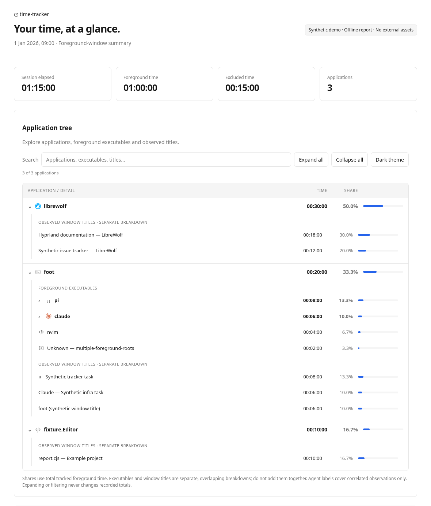
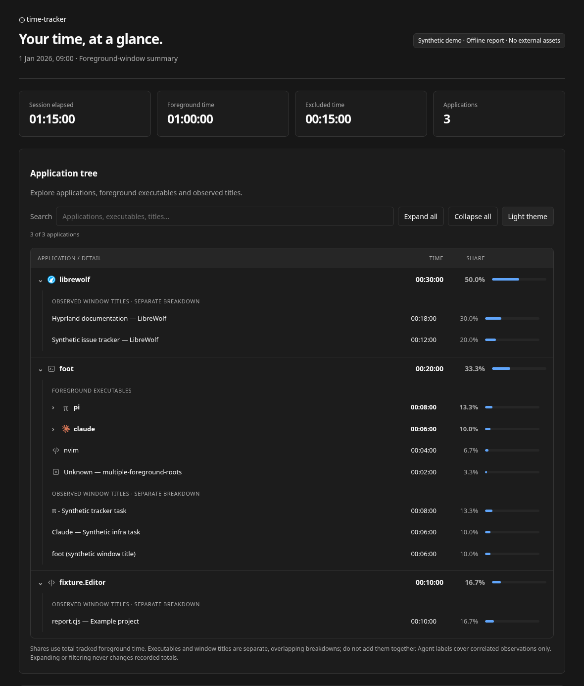
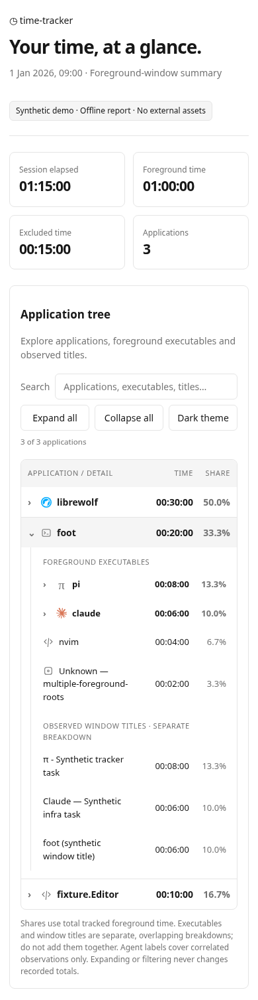

The offline report now uses the compact neutral visual style from Clavium and Dominium, with light/dark themes and an application tree based on the selected sketch A.

Applications expand into foreground executables and observed window titles; Pi/Claude executables can expand into correlated title-derived labels. Search filters applications and details, and clearing it restores the previous expansion. Expand/collapse controls, keyboard-accessible disclosures, mobile layout, and collapsible supporting tables keep the report usable at different sizes. Process rows include the approved 16px selfh.st Claude/LibreWolf icons and neutral terminal, code, Pi and generic fallbacks. Titles and session labels remain text-only. Icons are embedded offline with source attribution and CC BY 4.0 licensing. The synthetic example report and README are updated.

Executable and title breakdowns remain separate because they overlap. Shares continue to use the original tracked total, and filtering does not alter accounting. Reports remain self-contained with no external assets or network requests. One static embedded script is authorized by a SHA-256 CSP hash; report labels remain HTML-escaped. Native expansion still works with scripts disabled.

Validation: `node --test --test-reporter=tap poc/*.test.cjs`: 84 passed, 0 failed, 1 skipped (optional synthetic Wayland transport test lacks development tools). Chromium tests exercised search, nested expansion, bulk controls, restoration after search, keyboard access, light/dark switching, mobile overflow, CSP, malicious-label escaping, absence of network requests, and script-disabled fallback. Live Hyprland tracking was not exercised in the cloud environment; collection and accounting logic are unchanged.

## Screenshots

Synthetic data only, generated from the updated example report.

### Light theme

### Dark theme

### Mobile

