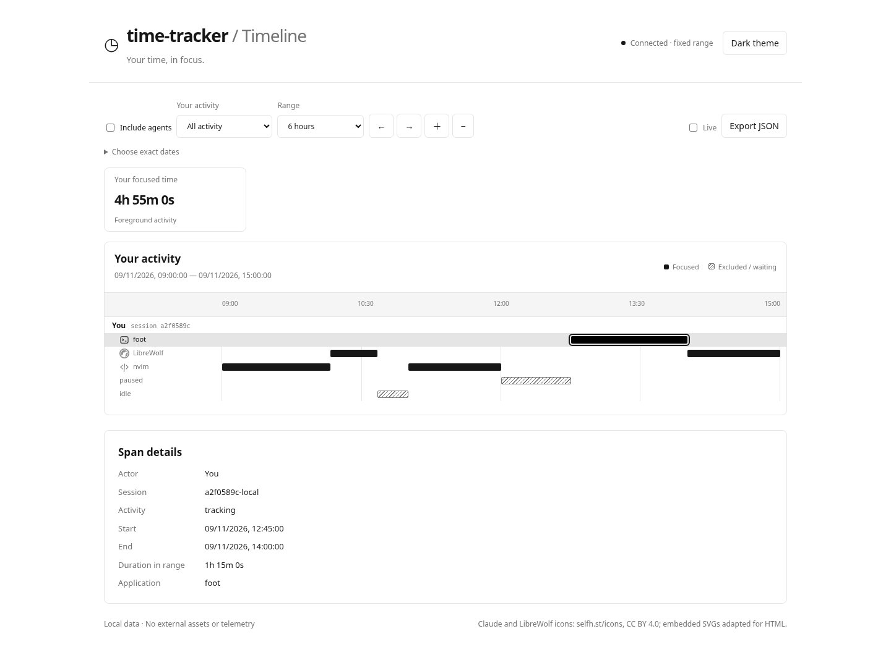
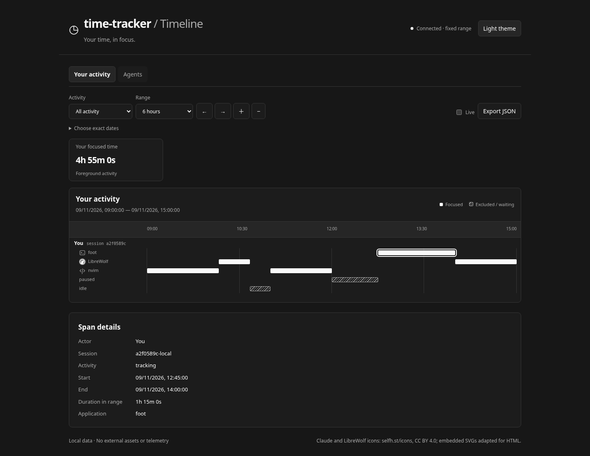
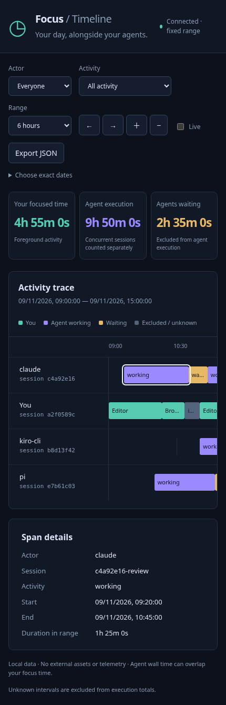

# Local timeline and background agents

The timeline is an opt-in local web app. You and each Claude Code, Pi, or Kiro
CLI session have independent lanes. Agent execution continues while you switch
applications, go idle, or pause the foreground tracker. Agent wall time can
overlap your focused time and other agents; it is not CPU time, token generation
time, or proof of productive work.

No npm install, database, Grafana instance, native addon, or compositor is needed
for the collector, agents, or viewer. Node.js 22+ and Linux `flock` are required.
The existing foreground tracker still needs its native/desktop prerequisites.
The viewer uses the report's compact neutral theme: light by default, with a
keyboard-accessible **Dark theme / Light theme** toggle. Switching themes does
not change the selected range, filters, span selection, or recorded totals.

## Screenshots

These captures use synthetic activity only, with independent human, Claude,
Pi, and Kiro CLI lanes. Agent execution overlaps personal focus, while waiting
is displayed separately. No real prompts, window titles, or activity history
are included.

### Light theme



### Dark theme



### Mobile



## Start the collector and viewer

From the repository root:

```sh
node poc/timeline-server.cjs
```

Open `http://127.0.0.1:4318` on **the same machine**. Keep the collector running.
It listens only on IPv4 loopback; use that exact address, not `localhost`.
The HTTP interface is read-only and rejects foreign Host/Origin requests.
Events arrive through a separate Unix socket, restricted to the local user.
This is a local single-user tool, not an authenticated multi-user server.

Use actor/activity filters, range presets, previous/next, zoom, or exact local
dates to explore up to 31 days at a time. Live mode refreshes every five seconds.
Click or keyboard-focus a span to inspect details. Export JSON downloads the
current filtered range; treat exported history as private. No external scripts,
fonts, assets, or telemetry are loaded.

Defaults:

- Storage: `$XDG_STATE_HOME/focus-tracker/timeline`, falling back to
  `~/.local/state/focus-tracker/timeline`.
- Journal: `events.jsonl`, append-only with a schema version per record.
- Ingestion socket: `collector.sock` in that directory.
- Port: `4318` (override with `--port PORT`; `0` chooses an available port).

For a separate history:

```sh
node poc/timeline-server.cjs --directory /absolute/private/timeline --port 4319
export FOCUS_TRACKER_SOCKET=/absolute/private/timeline/collector.sock
# Set the same variable in each terminal launching an agent or tracker.
```

The final directory must be owned by you and mode `0700`; new directories are
created with that mode. Journal/lock files and the socket are mode `0600`.

## Add your foreground activity

In a separate terminal, in the intended Hyprland session:

```sh
node poc/tracker.cjs --timeline
# Or explicitly select the socket:
node poc/tracker.cjs --timeline-socket /absolute/private/timeline/collector.sock
```

This adds chronological foreground/excluded intervals alongside the existing
summary checkpoint. Existing accounting, pause, idle/lock gating, checkpoints,
exports, and title opt-in remain independent. No prior intervals are fabricated
from old totals. `--titles` also permits titles in the timeline; without it,
timeline messages never contain titles. Precise application chronology itself
is sensitive, so interval persistence requires explicit `--timeline` opt-in.
`--no-state --timeline` disables the **summary checkpoint**, but still saves
timeline intervals. Omit `--timeline` to disable interval collection entirely.

A run gets its own human session lane. Adjacent intervals with identical context
are merged for display. Human focused totals use the union of focused intervals
if multiple trackers overlap; agent totals sum independent session execution.
Timeline totals and old summary totals can differ because recording started
later, the selected range is clipped, or a collector write failed.

## Claude Code

Generate the hook settings for this checkout and Node executable:

```sh
node poc/agent-config.cjs claude
```

For an explicit per-launch integration, Claude Code accepts a settings JSON
string. From the tracker repository, launch:

```sh
node poc/agent-run.cjs --agent claude -- claude \
  --settings "$(node poc/agent-config.cjs claude)"
```

Alternatively, merge the generated `hooks` entries into your existing Claude
settings, preserving other hooks, and launch with:

```sh
node /absolute/time-tracker/poc/agent-run.cjs --agent claude -- claude
```

Requires Claude Code command hooks including UserPromptSubmit, Stop,
PermissionRequest, PostToolUse, and SessionEnd. The generated settings also
cover current StopFailure and MCP elicitation events; upgrade Claude if its
settings parser does not recognize those events.

A submitted prompt starts execution. Stop/StopFailure marks the session waiting.
Permission requests, permission notifications, AskUserQuestion, and MCP
elicitation mark waiting; post-tool/post-elicitation events resume execution.
SessionEnd and launcher exit close the session. Esc/cancellation that does not
emit a completion hook may remain working until another lifecycle event or
process exit; the heartbeat proves process continuity, not that Claude is
currently generating. This is hook-observed task wall time.

A launcher invocation has an opaque random identity. Internal Claude subagents
belong to that invocation's task; they are not separate independently billed
actors. Separate launcher invocations get separate lanes.

## Kiro CLI

Generate the documented custom-agent hook configuration:

```sh
node poc/agent-config.cjs kiro-cli
```

Merge its `hooks` into your Kiro custom agent, retaining your existing tools,
permissions, instructions, and other hooks. Or save the generated configuration
as a **new**, otherwise unused `~/.kiro/agents/focus-tracker.json`, following
your installed Kiro CLI's custom-agent configuration instructions. Do not
replace an existing agent file. Start that agent through the launcher:

```sh
node /absolute/time-tracker/poc/agent-run.cjs --agent kiro-cli -- \
  kiro-cli chat --agent focus-tracker
```

`userPromptSubmit` starts execution; `stop` marks waiting; `postToolUse` confirms
execution. Hooks must have `cache_ttl_seconds: 0`, or repeated turns could be
missed. The `agentSpawn` hook establishes a waiting session.

Kiro's documented CLI hooks do not provide a distinct permission-wait or
session-end event. Waiting between turns is excluded, but approval pauses
**inside a turn are included in task wall time**. Launcher exit closes the
session. A future dedicated permission/cancellation adapter can refine this
without pretending tool/process polling can identify those boundaries.

## Pi

Load the extension explicitly (no automatic changes to Pi configuration):

```sh
pi -e /absolute/time-tracker/poc/integrations/pi-timeline.mjs
```

Pi's extension manages its own session identity, heartbeat, and shutdown; do not
also wrap Pi with `agent-run.cjs`. New/resumed/forked sessions get fresh lanes.
The extension only subscribes to lifecycle events; it never inspects messages,
transcripts, tool arguments, or session files.

Requires Pi's `agent_settled` and `ui_prompt_start`/`ui_prompt_end` extension
events. `agent_start` begins execution, blocking extension UI prompts pause it,
and `agent_settled` ends it after automatic retries, compaction retries, and
queued continuations. `agent_end` is deliberately not used as the final idle
signal because current Pi may automatically continue after it. Update Pi if
these events are unavailable. `session_shutdown` closes the lane's activity.

## Reliability and privacy boundaries

- Agents send only the agent name, an opaque session ID, and a lifecycle state.
  Hook stdin is bounded, parsed locally, and discarded; prompts, responses,
  session paths, working directories, tool arguments/results, and credentials
  are never forwarded or stored. Integrations are opt-in and do not read agent
  history directories. Sessions have IDs rather than prompt-derived names.
- Launcher/extension heartbeats run every 10 seconds. A missing heartbeat for
  more than 45 seconds cuts execution back to its **last observed event** and
  labels the remaining interval unknown, excluding it from totals. Until expiry,
  the current interval is provisional. This can undercount abrupt crashes.
- An expired session cannot resume from a heartbeat alone; the next explicit
  lifecycle transition establishes its state. The same applies after collector
  restart. Restarting a collector does not infer what an agent did while it was
  absent; restart the agent or wait for its next lifecycle event.
- The collector serializes concurrent event writers, uses `flock` to prevent a
  second collector, fsyncs each acknowledged append, and repairs only an
  incomplete final frame after a crash. Malformed complete records are preserved
  and rejected, not silently dropped. On restart open tasks end at their last
  evidence, excluding downtime. Unacknowledged events can be lost or present.
  A storage write failure stops further appends and makes the viewer report
  unavailable until storage is fixed and the collector restarted, preserving
  the ability to repair a partial tail safely.
- Agent hooks never output agent context, block a tool, approve a permission,
  or fail the agent command. They warn on stderr if recording fails. The
  launcher checks the collector before starting and preserves the child exit
  code. Always verify that a test turn produces a **working** span: missing hooks
  leave the launcher's lane waiting rather than inventing execution time.
- Foreground intervals are buffered for at most about five seconds during
  normal sampling and flushed on clean shutdown. Collector failures log a
  warning and leave existing foreground accounting/checkpoints working. Failed
  intervals are not retried or backfilled; long sampling gaps over 60 seconds
  are omitted. Both timelines use local wall-clock positions; human durations
  are mapped from the accounting monotonic clock. Large clock adjustments may
  cause validation failures or imprecise alignment; no distributed clock
  synchronization or billing-grade accuracy is claimed.
- Journal capacity is 64 MiB. At capacity, new events fail visibly rather than
  silently evicting history. Stop the collector and agent writers, archive the
  **entire private directory**, then select a new private directory for a fresh
  history. No automatic rotation, historical import, or cross-machine sync is
  provided. The viewer returns at most the newest 10,000 matching spans, with
  an explicit truncation notice; narrow the range to inspect the rest. Totals
  still cover all matching spans.
- The viewer's HTTP API is read-only. The Unix socket trusts this OS user; other
  processes running as that same user can submit events or read local history.
  Do not expose the viewer through a public reverse proxy.

## Validation

```sh
node --test poc/*.test.cjs
```

Timeline tests exercise independent overlapping agents, clipping, stale sessions,
restarts, privacy, crash-tail recovery, lock exclusion, real IPC/HTTP, fail-open
hooks, the Pi lifecycle adapter, an actual launcher + hook subprocess, and the
foreground tracker with a synthetic native fixture. They do not call live AI
services or require their credentials. Live Claude/Pi/Kiro compatibility must
also be checked against the versions installed on your desktop.

For optional browser verification, install Playwright in a separate temporary
prefix and use the installed Chromium, without adding application dependencies:

```sh
npm install --prefix /tmp/focus-browser playwright
NODE_PATH=/tmp/focus-browser/node_modules node poc/timeline-browser-check.cjs
```

The check seeds synthetic in-memory activity, starts an isolated collector, and
validates lane rendering, safe text, span details, filters, navigation, live
mode, download, light/dark switching by keyboard, theme retention across
refreshes, and mobile layout. It cleans up its private test history.

Integration references used during implementation:

- [Claude Code hook types](https://github.com/anthropics/claude-code/blob/main/mods/types/claude-code.d.ts)
- [Pi extension lifecycle](https://github.com/badlogic/pi-mono/blob/main/packages/coding-agent/docs/extensions.md)
- [Kiro/Q CLI hooks](https://github.com/aws/amazon-q-developer-cli/blob/main/docs/hooks.md)
- [Kiro/Q custom-agent format](https://github.com/aws/amazon-q-developer-cli/blob/main/docs/agent-format.md#hooks-field)
